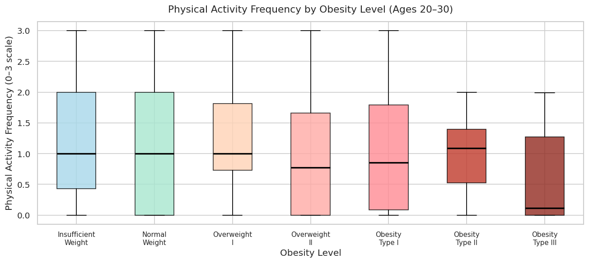
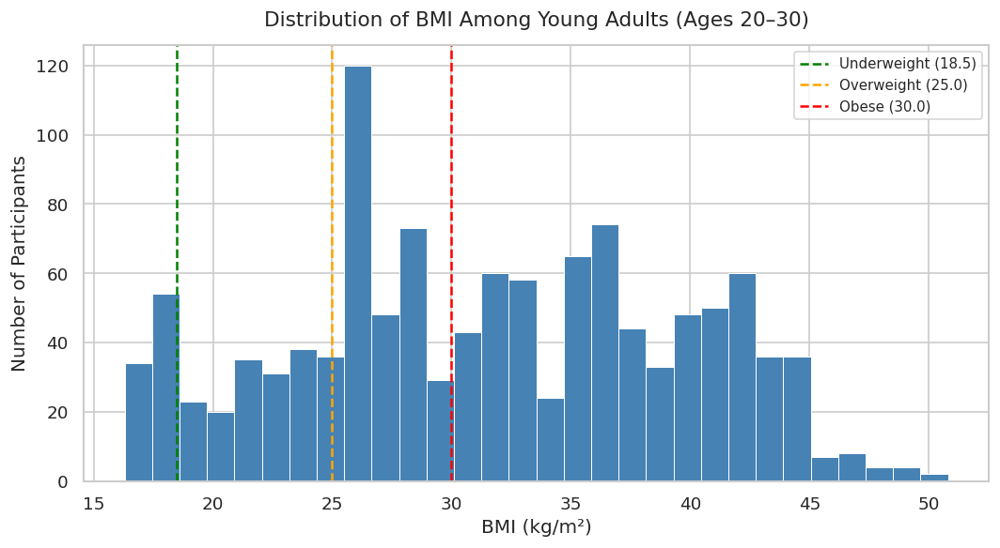
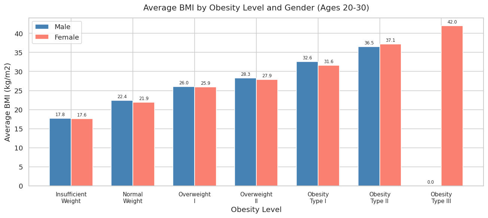
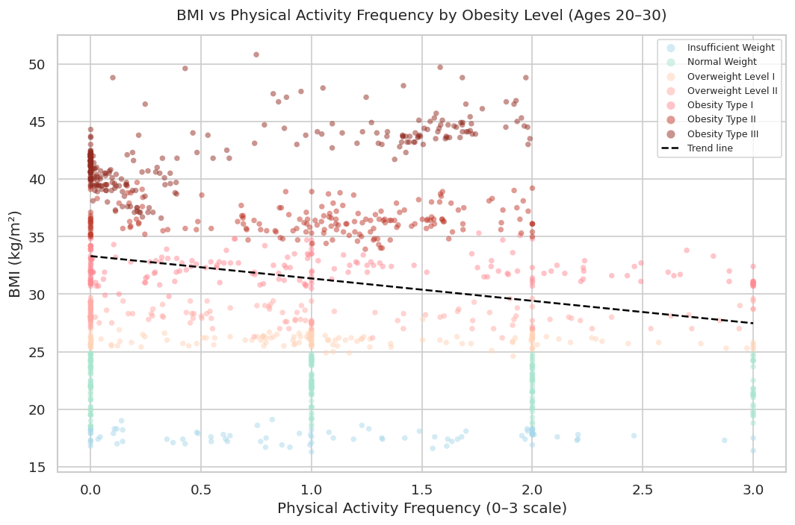
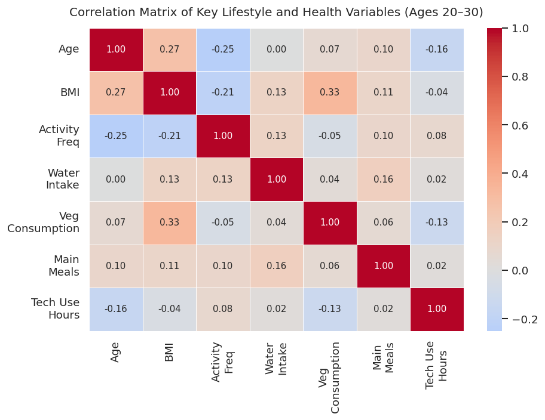

# Obesity Levels and Lifestyle Habits Among Young Adults (20–30)

An exploratory data analysis in Python of how eating habits, physical activity and transport choices relate to obesity in young adults. It covers data cleaning, statistical testing and five visualisations, each with a written interpretation.



## Key findings
- **Most of the sample is overweight or obese.** Mean BMI for ages 20–30 is **31.5 kg/m²**, and the distribution is right-skewed.
- **More activity goes with lower BMI.** Pearson **r = −0.206** (p < 0.0001); median activity frequency falls steadily from normal weight to Obesity Type III.
- **Activity alone doesn't explain much.** Linear regression gives a slope of **−1.93 BMI per unit of activity**, but **R² = 0.043**, so diet, genetics and other factors matter more.
- **Screen time doesn't predict BMI** in this sample (p = 0.228).
- Water intake shows a small positive correlation with BMI (r = 0.128), likely because heavier people drink more in absolute terms.

## Data cleaning
- Renamed cryptic columns (e.g. `FAF` → `Physical_Activity_Freq`, `NObeyesdad` → `Obesity_Level`)
- Removed 24 duplicate rows
- Filtered to ages 20–30: **2,111 → 1,197 participants**
- Added a calculated **BMI** column
- Ran IQR outlier detection; the 2 height outliers were plausible, so they were kept and the decision was documented
- Set obesity levels as an ordered category so charts follow the medical scale

## Visualisations
| | |
|---|---|
|  |  |
|  |  |

## Tools
Python: pandas, NumPy, Matplotlib, Seaborn, SciPy (Pearson correlation, one-way ANOVA, linear regression)

## Files
- `obesity_analysis.ipynb`: full notebook with code, outputs and written analysis for every step
- `ObesityDataSet_raw_and_data_sinthetic.csv`: the dataset
- `figures/`: charts exported from the notebook

## Run it
```bash
pip install -r requirements.txt
jupyter notebook obesity_analysis.ipynb
```

## Data source
Palechor, F.M. & de la Hoz Manotas, A. (2019). *Dataset for estimation of obesity levels based on eating habits and physical condition.* [UCI Machine Learning Repository](https://archive.ics.uci.edu/dataset/544/estimation+of+obesity+levels+based+on+eating+habits+and+physical+condition). Licensed under CC BY 4.0.

**Note:** about 77% of the original records were generated synthetically (SMOTE) by the dataset authors to balance the classes, so findings describe this dataset, not a real population.

*Completed for IS41570, University College Dublin.*
